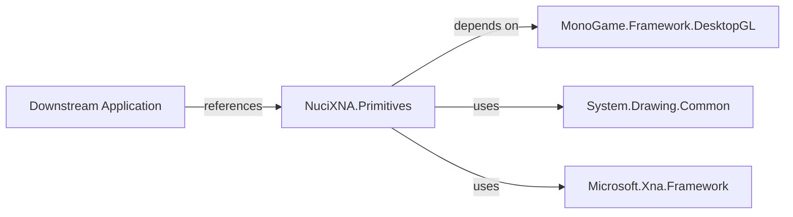
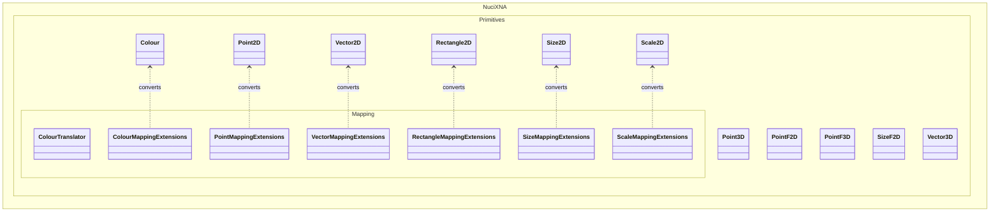
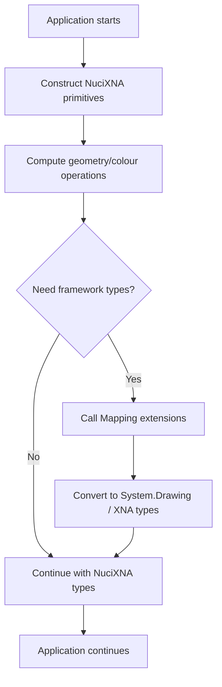
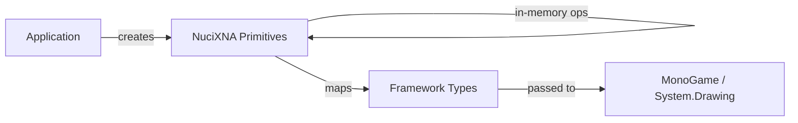
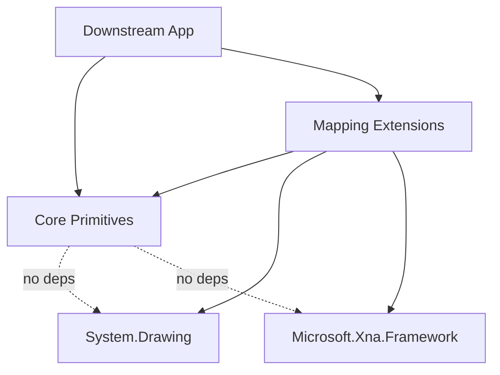

# NuciXNA.Primitives Architecture

This document describes the current architecture of NuciXNA.Primitives, a .NET library providing reusable geometry, size, scale, vector, rectangle, and colour types for MonoGame/XNA projects. It covers the library's structure, components, dependencies, and design decisions.

## 📑 Table of Contents

- [Purpose](#-purpose)
- [System Context](#-system-context)
- [Architectural Style](#-architectural-style)
- [Runtime Flow](#-runtime-flow)
- [Architectural Areas](#-architectural-areas)
- [Data Architecture](#-data-architecture)
- [Interfaces and Integrations](#-interfaces-and-integrations)
- [Cross-Cutting Concerns](#-cross-cutting-concerns)
- [Dependency Direction and Rules](#-dependency-direction-and-rules)
- [External Dependencies](#-external-dependencies)
- [Deployment and Operations](#-deployment-and-operations)
- [Compatibility Contracts](#-compatibility-contracts)
- [Testing and Verification](#-testing-and-verification)
- [Design Constraints](#-design-constraints)
- [Extension Points](#-extension-points)
- [Source Map](#-source-map)
- [Related Documentation](#-related-documentation)

## 🎯 Purpose

NuciXNA.Primitives is a .NET class library that provides domain-friendly geometry and colour primitives for applications built on MonoGame/XNA. It sits between application code, `System.Drawing`, and MonoGame primitives, enabling developers to keep their own types while converting to framework types when needed. The library targets `net10.0` and is distributed as a NuGet package.

## 🌐 System Context

NuciXNA.Primitives is a library consumed by downstream applications. It has no runtime process, server, or background services. The system boundary is the NuGet package and its public API surface.



The principal external boundaries are:
- **Downstream Applications:** Consume the library via NuGet or source; control their own data and lifecycle.
- **MonoGame.Framework.DesktopGL:** Provides `Microsoft.Xna.Framework` types (Vector2, Vector3, Point, Rectangle, Color) used for mapping extensions.
- **System.Drawing.Common:** Provides `System.Drawing` types (Point, Size, Rectangle, Color) used for mapping extensions.
- **NuGet.org:** Distribution channel for the packaged library.

## 🏗️ Architectural Style

NuciXNA.Primitives follows a **library/SDK architectural style** with these characteristics:

- **Public contract-first:** The public API consists of immutable value types (structs) and static extension methods.
- **Zero runtime dependencies beyond .NET and MonoGame:** No internal services, no background threads, no I/O.
- **Mapping layer pattern:** Extension methods in the `Mapping` namespace provide bidirectional conversions between NuciXNA types and `System.Drawing` / `Microsoft.Xna.Framework` types.
- **No inheritance hierarchies:** All primitives are structs implementing `IEquatable<T>` for value equality.



The principal architecture boundaries are:
- **Core Primitives (`NuciXNA.Primitives` namespace):** Value types for geometry and colour; no external dependencies beyond .NET base class library.
- **Mapping Extensions (`NuciXNA.Primitives.Mapping` namespace):** Static extension methods depending on `System.Drawing` and `Microsoft.Xna.Framework`; optional for consumers who don't need interop.

## 🔄 Runtime Flow

NuciXNA.Primitives has no runtime process. The "runtime flow" is the sequence of type construction and mapping operations invoked by downstream code:



The principal runtime sequence is:
1. Application constructs NuciXNA primitive instances (e.g., `new Point2D(10, 20)`, `new Colour(255, 0, 0)`).
2. Application performs in-memory computations (arithmetic, equality, containment checks).
3. If interop is needed, application calls mapping extension methods (e.g., `point.ToXnaPoint()`, `colour.ToXnaColor()`).
4. Converted framework types are passed to MonoGame or System.Drawing APIs.

## 🗂️ Architectural Areas

### Core Primitives

Paths:
- `NuciXNA.Primitives/Colour.cs`
- `NuciXNA.Primitives/Point2D.cs`
- `NuciXNA.Primitives/Point3D.cs`
- `NuciXNA.Primitives/PointF2D.cs`
- `NuciXNA.Primitives/PointF3D.cs`
- `NuciXNA.Primitives/Size2D.cs`
- `NuciXNA.Primitives/SizeF2D.cs`
- `NuciXNA.Primitives/Scale2D.cs`
- `NuciXNA.Primitives/Rectangle2D.cs`
- `NuciXNA.Primitives/Vector2D.cs`
- `NuciXNA.Primitives/Vector3D.cs`

Responsibilities:
- Define immutable value types for 2D/3D points (integer and floating-point), sizes, scales, rectangles, vectors, and colours.
- Implement value equality via `IEquatable<T>` and operator overloads.
- Provide arithmetic operators (`+`, `-`, `*`, `/`) where mathematically meaningful.
- Expose convenience properties (e.g., `Rectangle2D.Centre`, `Size2D.Area`, `Vector2D.Zero`).

Boundary rules:
- No dependencies on `System.Drawing` or `Microsoft.Xna.Framework`.
- No I/O, no threading, no static mutable state.
- All types are `struct` (except `Colour` which is a `sealed class` for historical reasons).

### Mapping Extensions

Paths:
- `NuciXNA.Primitives/Mapping/ColourTranslator.cs`
- `NuciXNA.Primitives/Mapping/ColourMappingExtensions.cs`
- `NuciXNA.Primitives/Mapping/PointMappingExtensions.cs`
- `NuciXNA.Primitives/Mapping/VectorMappingExtensions.cs`
- `NuciXNA.Primitives/Mapping/RectangleMappingExtensions.cs`
- `NuciXNA.Primitives/Mapping/SizeMappingExtensions.cs`
- `NuciXNA.Primitives/Mapping/ScaleMappingExtensions.cs`

Responsibilities:
- Provide bidirectional extension methods for converting between NuciXNA types and `System.Drawing` / `Microsoft.Xna.Framework` types.
- `ColourTranslator` handles ARGB integer and hexadecimal string conversions.
- All mapping methods are pure functions with no side effects.

Boundary rules:
- Depend on `System.Drawing.Common` and `MonoGame.Framework.DesktopGL` (transitively via `Microsoft.Xna.Framework`).
- No dependencies back to Core Primitives beyond the types being extended.
- Optional for consumers; applications not needing interop can avoid referencing mapping assemblies.

## 💾 Data Architecture

NuciXNA.Primitives does not own, persist, cache, or transmit data. All data is transient in-memory values owned by the downstream application.



| Data or Store | Owner | Representation and Storage | Lifecycle or Consistency |
|---------------|-------|----------------------------|--------------------------|
| Primitive instances | Downstream application | Stack-allocated structs / heap-allocated `Colour` class | Transient; lifetime bound to application scope |
| Framework type conversions | Downstream application | `System.Drawing` / `Microsoft.Xna.Framework` structs | Transient; created on demand via mapping extensions |

## 🔌 Interfaces and Integrations

| Interface or Integration | Direction | Contract | Owner | Failure Semantics |
|--------------------------|-----------|----------|-------|-------------------|
| NuGet package | Outbound | `.nupkg` with `net10.0` TFM, GPL-3.0-or-later | Project maintainers | Build fails if package invalid |
| `System.Drawing.Common` | Inbound | `Point`, `Size`, `Rectangle`, `Color` structs | .NET runtime | `TypeLoadException` if missing |
| `Microsoft.Xna.Framework` | Inbound | `Vector2`, `Vector3`, `Point`, `Rectangle`, `Color` structs | MonoGame | `TypeLoadException` if missing |
| Mapping extension methods | Bidirectional | Extension methods on framework types | NuciXNA.Primitives | `ArgumentNullException` for null inputs; `FormatException` for invalid hex |

## 🧵 Cross-Cutting Concerns

### Error Handling

- Constructors validate inputs where applicable (e.g., `Colour.FromHexadecimal` throws `ArgumentNullException` for null, `FormatException` for invalid format).
- Arithmetic operations do not overflow-check by default (standard .NET struct behavior).
- Mapping extensions throw `ArgumentNullException` for null reference inputs.
- No global exception handling; exceptions propagate to caller.

### Concurrency and Resource Use

- All primitives are immutable or have mutable properties with no shared state.
- No locks, no thread-static fields, no async operations.
- Safe for concurrent use across threads without synchronization.
- No resource disposal required (no `IDisposable`).

### Configuration

- No configuration system. Library behavior is fixed at compile time.
- Target framework (`net10.0`) and dependency versions declared in `.csproj`.

## 🧭 Dependency Direction and Rules



The principal dependency rules are:
- **Core Primitives** have zero external dependencies beyond .NET BCL.
- **Mapping Extensions** depend on Core Primitives, `System.Drawing.Common`, and `Microsoft.Xna.Framework` (via MonoGame).
- **Downstream applications** may depend on Core Primitives alone, or Core + Mapping.
- **Prohibited:** Core Primitives must not reference `System.Drawing` or `Microsoft.Xna.Framework`.
- **Prohibited:** Circular dependencies between Core and Mapping.

## 📦 External Dependencies

| Dependency | Responsibility | Integration Boundary | Architectural Consequence |
|------------|----------------|----------------------|---------------------------|
| `MonoGame.Framework.DesktopGL` 3.8.4 | Provides `Microsoft.Xna.Framework` vector, point, rectangle, color types | Mapping Extensions | Required for XNA interop; transitively pulls in `Microsoft.Xna.Framework` |
| `System.Drawing.Common` (built-in) | Provides `System.Drawing` point, size, rectangle, color types | Mapping Extensions | Required for System.Drawing interop; part of .NET SDK |
| `Microsoft.NET.Test.Sdk` 18.3.0 | Test runner infrastructure | Unit test project | Test-only; not in production package |
| `NUnit` 4.5.1 | Test framework | Unit test project | Test-only; not in production package |
| `NUnit3TestAdapter` 6.2.0 | Test adapter for Visual Studio / CLI | Unit test project | Test-only; not in production package |

## 🚀 Deployment and Operations

| Concern | Current Design | Architectural Consequence |
|---------|----------------|---------------------------|
| Deployment unit | NuGet package (`.nupkg`) | Single assembly + XML docs; no native assets |
| Target framework | `net10.0` | Runs on .NET 10+; not compatible with .NET Framework |
| Persistent state | None | No migrations, no schema, no backup concerns |
| Scaling | N/A (library) | No horizontal/vertical scaling concerns |
| Startup/shutdown | N/A (library) | No initialization or cleanup required |
| Operator-visible outputs | None | No logs, metrics, health endpoints |

## 🛡️ Compatibility Contracts

| Contract | Owner | Invariant | Verification | Change Policy |
|----------|-------|-----------|--------------|---------------|
| Public API surface (types, members) | Core Primitives | No breaking changes without major version bump | `dotnet build` + unit tests | Semantic versioning; major version for breaking changes |
| Mapping extension method signatures | Mapping Extensions | Stable conversion behavior | Unit tests in `Mapping/*Tests.cs` | Same as public API |
| NuGet package metadata (id, version, TFM) | Project maintainers | Valid `.nupkg` per NuGet spec | `dotnet pack` + validation | Automated via CI |
| GPL-3.0-or-later license | Project maintainers | License header in source; `PackageLicenseExpression` in csproj | Manual review | Requires legal review to change |

## ✅ Testing and Verification

The solution contains two projects:
- `NuciXNA.Primitives` — library under test
- `NuciXNA.Primitives.UnitTests` — NUnit test project covering all primitives and mapping extensions

Execute the principal automated verification with:

```bash
dotnet test NuciXNA.sln --configuration Release
```

Test coverage includes:
- Construction, equality, and arithmetic for all primitive types
- Edge cases (empty/zero values, boundary conditions)
- Bidirectional mapping correctness for all extension methods
- `ColourTranslator` hex/ARGB round-trips

## ⚠️ Design Constraints

- **Target framework lock-in:** `net10.0` only; no multi-targeting. Consumers must use .NET 10+.
- **MonoGame version coupling:** Mapping extensions depend on `MonoGame.Framework.DesktopGL` 3.8.4; upgrading may require mapping updates.
- **`Colour` as class:** Unlike other primitives, `Colour` is a `sealed class` (not a struct) for historical reasons; this causes heap allocation and reference semantics.
- **No `System.Numerics` integration:** Vectors don't implement `System.Numerics` interfaces; interop requires manual conversion.
- **No 3D rectangle/size types:** Only 2D rectangle and size primitives exist.
- **GPL-3.0-or-later license:** Viral copyleft; downstream applications must be GPL-compatible.

## 🔧 Extension Points

### Adding New Primitive Types

1. Create a new `struct` (or `sealed class` if reference semantics required) in `NuciXNA.Primitives/` implementing `IEquatable<T>`.
2. Add constructors, properties, operators, and convenience members following existing patterns.
3. Add corresponding mapping extensions in `NuciXNA.Primitives/Mapping/` if interop with `System.Drawing` or `Microsoft.Xna.Framework` is needed.
4. Add unit tests in `NuciXNA.Primitives.UnitTests/` mirroring existing test structure.
5. Run `dotnet test` to verify.

### Adding New Mapping Targets

1. Add extension methods in a new or existing `*MappingExtensions.cs` file in `NuciXNA.Primitives/Mapping/`.
2. Follow the bidirectional pattern: `ToNuciXnaType` and `ToExternalType`.
3. Handle null inputs with `ArgumentNullException`.
4. Add unit tests for round-trip conversions.

## 🗺️ Source Map

| Area | Repository-Relative Path |
|------|--------------------------|
| Solution | `NuciXNA.sln` |
| Library project | `NuciXNA.Primitives/NuciXNA.Primitives.csproj` |
| Core primitives | `NuciXNA.Primitives/*.cs` (excluding `Mapping/`) |
| Mapping extensions | `NuciXNA.Primitives/Mapping/*.cs` |
| Unit tests | `NuciXNA.Primitives.UnitTests/*.cs` |
| Test project | `NuciXNA.Primitives.UnitTests/NuciXNA.Primitives.UnitTests.csproj` |
| Documentation | `README.md`, `PRIVACY.md`, `SECURITY.md`, `LICENSE` |

## 📚 Related Documentation

- [README.md](README.md) — Project overview, installation, usage examples
- [PRIVACY.md](PRIVACY.md) — Data handling policy (no personal data collected)
- [SECURITY.md](SECURITY.md) — Vulnerability reporting and disclosure policy
- [LICENSE](LICENSE) — GPL-3.0-or-later license text